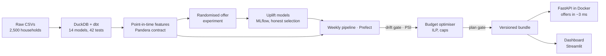
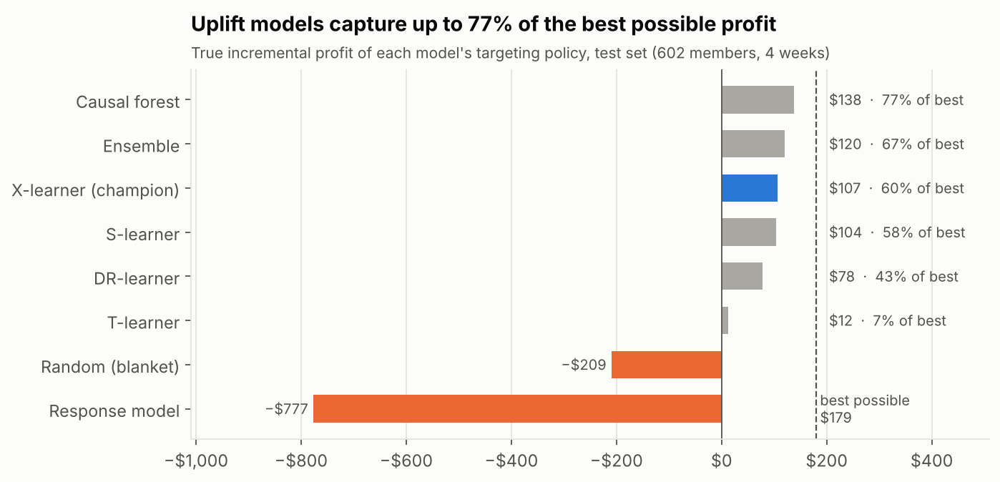
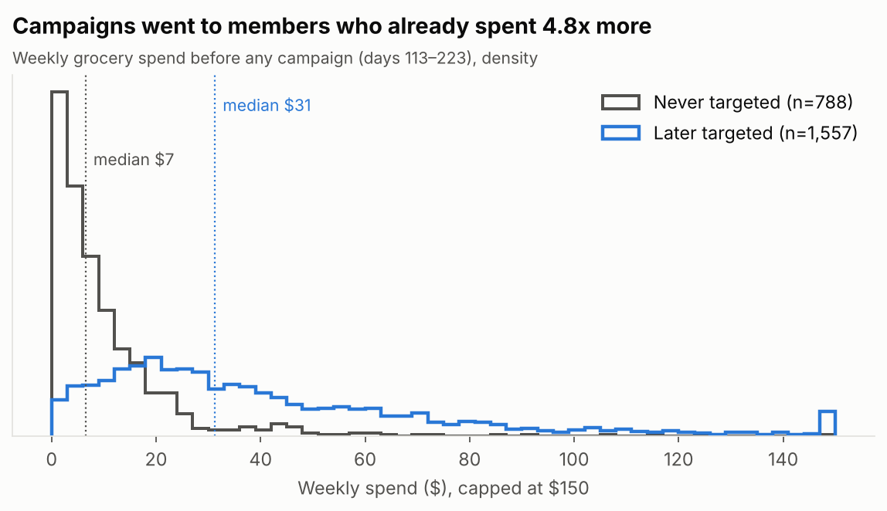
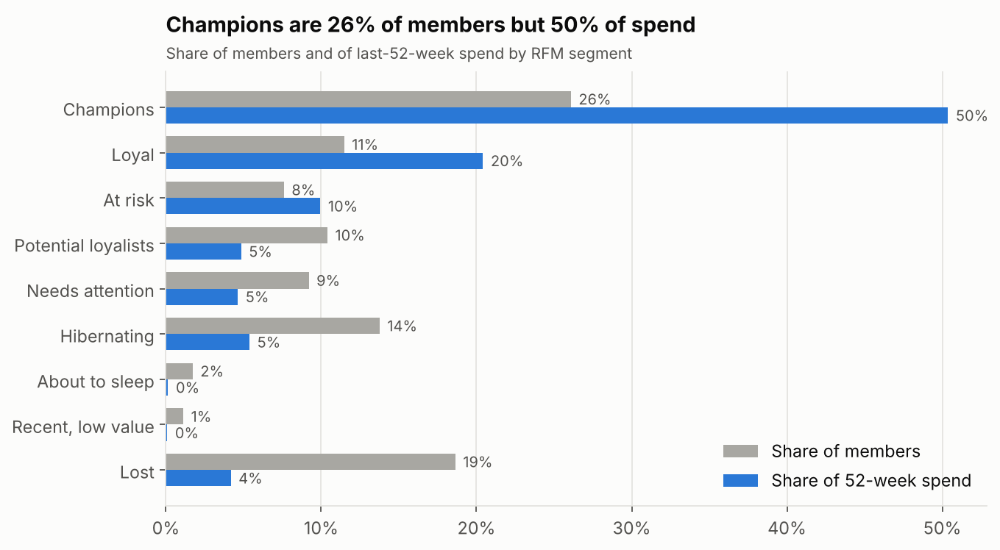
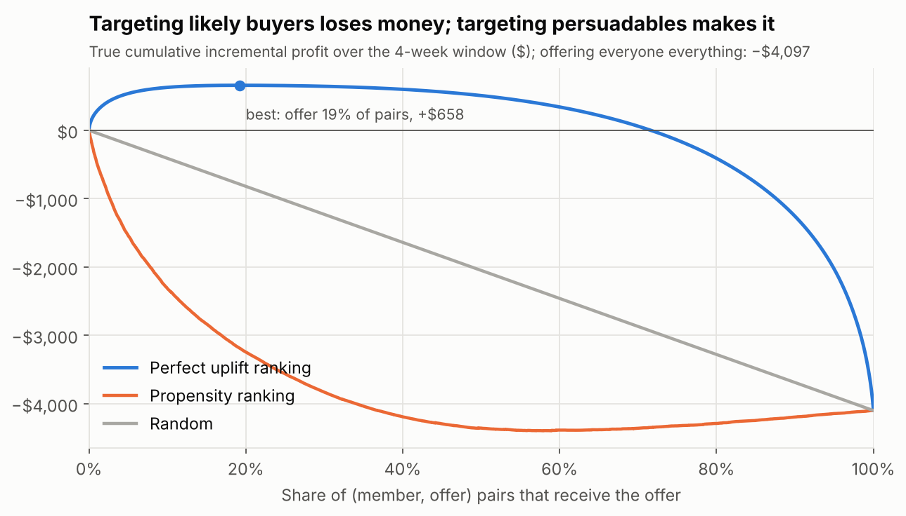
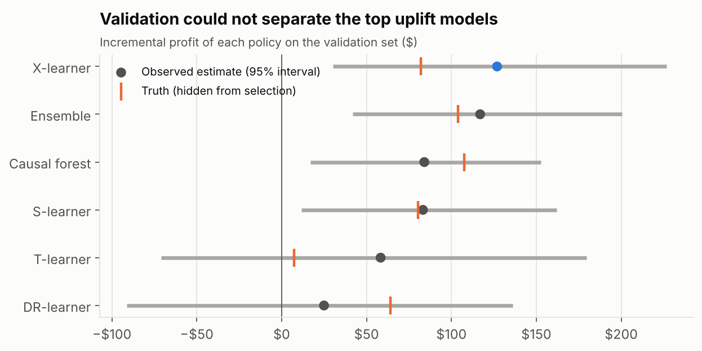
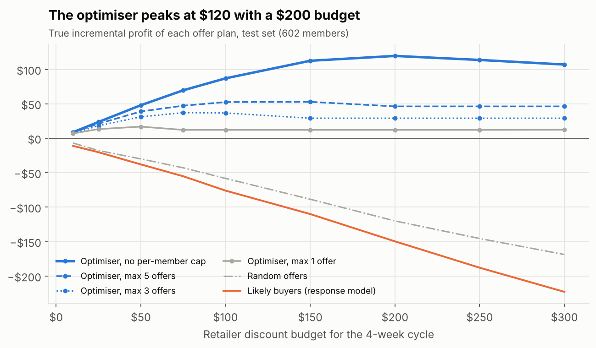
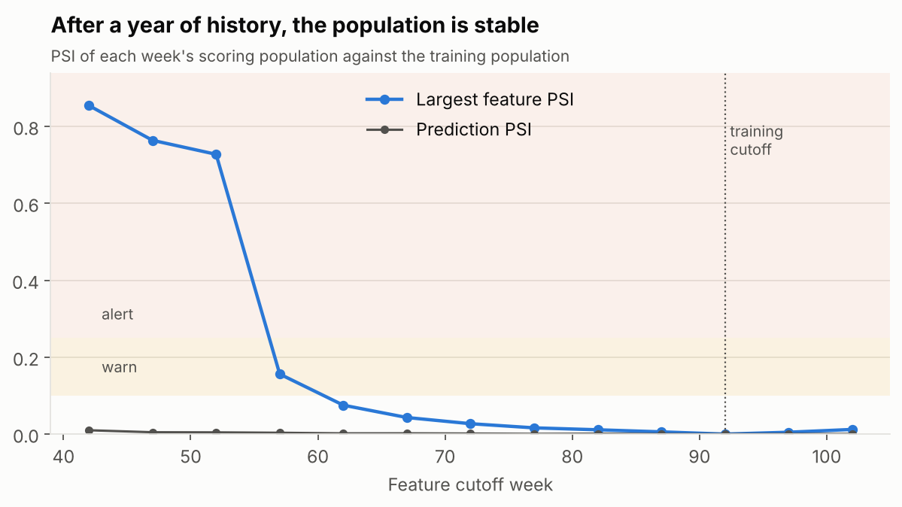

# Nectar Offer Engine

[](https://github.com/TilakHeble/nectar-offer-engine/actions/workflows/ci.yml)

**Which loyalty members should get which personalised offer, so that each £ of discount buys the most *incremental* profit?**

An end-to-end, production-style project modelled on Sainsbury's **Nectar Prices**: real grocery transactions, a randomised offer experiment on top, uplift models, a budget optimiser, an offer API in Docker, and a gated weekly pipeline with drift and fairness checks.

**Start here**
- 📄 [Business case (2 pages)](docs/business_case.md): the problem, results and rollout plan, written for a commercial audience
- 🧾 [Model card](docs/model_card.md): intended use, performance, fairness check, limitations, monitoring
- 📊 Dashboard: `streamlit run dashboards/app.py` (or [deploy it free](#dashboard))
- 📓 Notebooks [01](notebooks/01_eda.ipynb) · [02](notebooks/02_segments_and_funnel.ipynb) · [03](notebooks/03_offer_experiment.ipynb) · [04](notebooks/04_uplift_models.ipynb) · [05](notebooks/05_offer_allocation.ipynb) · [06](notebooks/06_monitoring.ipynb)



> Status: **all 10 weeks complete.** 106 tests and CI on every push (lint, dbt compile, tests, Docker build + container smoke test).

## Headline result

On a held-out test set, **uplift targeting turns a loss-making offer programme profitable**. The selected model (X-learner) earns +$107 of incremental profit where blanket offers lose $209 and a "likely buyer" model loses $777. The best model captures 77% of the best possible profit. The champion was chosen on validation data without access to the ground truth.



## Why uplift, not "who is likely to buy"

A propensity model sends offers to people who would have bought anyway, so the discount is lost margin. Uplift modelling targets the members whose behaviour *changes because of* the offer.

The EDA shows why this matters on real data: the retailer's historical campaigns went to members who **already spent 4.8x more per week before any campaign started**. Comparing targeted with non-targeted members would measure *who was chosen*, not *what the offer did*.



## Data

[dunnhumby — *The Complete Journey*](https://www.dunnhumby.com/source-files/): 2,500 households, ~2.6m transaction lines over 711 days (102 weeks), plus products, demographics, 30 campaigns, coupons, redemptions and in-store promotions. Amounts are in US dollars, as recorded.

| Dataset concept | Nectar framing |
|---|---|
| Household | Nectar member |
| Retail (loyalty-card) discount | Nectar Prices member price |
| Campaign / coupon | Personalised offer campaign |
| Basket | Shopping trip |

Real Nectar data is not public. Because historical campaigns were not randomised, a **simulated randomised experiment** is generated on top of the real members (week 3), using their real behavioural features to drive a known ground-truth uplift.

## Week 1 findings

| # | Finding | Decision |
|---|---|---|
| 1 | Members join the panel over weeks 1–16 | Model windows start at week 17 |
| 2 | Fuel / misc lines have non-unit quantities (up to ~90k) | Excluded from the `grocery_lines` view |
| 3 | Top 20% of members = 52% of grocery spend | Report impact by value segment |
| 4 | Median basket $16; half of members shop < once a week | Frequency and recency are core features |
| 5 | 50% of lines carry a member discount (15.6% of shelf value); rate per member spans 10%–23% | Price sensitivity drives simulated offer response |
| 6 | Historical campaigns targeted heavier spenders (median $31 vs $7 a week, pre-campaign) | Build a randomised simulator for clean uplift |
| 7 | Demographics for 32% of members only, 95% of whom were targeted | Behavioural features for modelling; demographics for fairness checks |

Full analysis: [`notebooks/01_eda.ipynb`](notebooks/01_eda.ipynb) (HTML export in `reports/`).

## Week 2: warehouse, segments and the offer funnel

**dbt data model** (`dbt/`, DuckDB). Every model is tested: uniqueness, relationships, value ranges, and reconciliation checks such as "panel spend equals basket spend to the cent".

| Layer | Model | Grain |
|---|---|---|
| Staging | `stg_transactions`, `stg_products`, `stg_households`, `stg_campaigns`, `stg_campaign_members`, `stg_coupons`, `stg_coupon_redemptions` | Cleaned, renamed source tables |
| Facts | `fct_line` | Grocery basket line |
| | `fct_basket` | Shopping trip |
| | `fct_member_week` | Member × week (dense, weeks 17–101, zeros included) |
| | `fct_member_campaign` | Member × campaign offer funnel |
| Dimensions | `dim_member`, `dim_product` | Member / product |
| Analytics | `mart_member_rfm` | Member: 52-week RFM scores and segment |



| # | Finding | Implication |
|---|---|---|
| 1 | Champions are 26% of members and 50% of 52-week spend; with Loyal, 38% of members and 71% of spend | Blanket offers to them leak the most margin |
| 2 | 77% of targeted members bought an offer product, but only 12% redeemed a coupon | Buying promoted products is mostly not driven by the coupon |
| 3 | 84% of *untargeted* shoppers bought Type A offer products anyway | Redemption and purchase rates overstate offer impact |
| 4 | Redemption rate is 8% for the lightest pre-campaign spend quintile, 17% for the heaviest | A propensity model would chase heavy shoppers who need offers least |

Full analysis: [`notebooks/02_segments_and_funnel.ipynb`](notebooks/02_segments_and_funnel.ipynb).

## Week 3: the randomised offer experiment

Because the real campaigns were not randomised, `src/nectar/simulate/simulator.py` runs a **randomised experiment on top of the real members**:

- 2,407 active members × 18 category offers (10/20/30% off, 4 weeks) = 43,326 member-offer pairs, each randomly assigned to offer or control (50/50).
- **Baseline buying is calibrated to reality:** a logistic model fitted on what members really bought in weeks 92–95 (cross-validated AUC 0.84). The simulated control group matches the real purchase rate offer by offer, within 3 percentage points.
- **The true effect is known:** each pair's uplift comes from a documented persuadability function (price sensitivity, category familiarity, lapsed buying, spend level, discount depth, plus an unobserved member effect). Ground truth is stored in `gt_` columns that models never see.
- **No leakage:** features use weeks 17–91 only. A test rebuilds them on data truncated at week 92 and checks they are identical.
- **Economics:** 30% gross margin, half of each discount funded by the brand (stated assumptions in `SimConfig`).



| Check | Result |
|---|---|
| Balance | All standardised mean differences < 0.05 |
| A/B recovery | Difference in means recovers the true uplift (4.0 pts) and true profit effect within the 95% CI |
| Offers on average | +4 pts conversion, but they **lose money** when sent to everyone |
| Who moves | Uplift peaks among occasional buyers; the 10% most likely buyers move by only 0.6 pts |
| The prize | Perfect uplift targeting turns −$4,097 (offer everyone) into +$658 (offer 19% of pairs); propensity targeting does worse than random |

Full validation: [`notebooks/03_offer_experiment.ipynb`](notebooks/03_offer_experiment.ipynb).

## Weeks 4–6: feature contract, uplift models and selection

- **Feature contract** (`features/schema.py`, Pandera): types, ranges, uniqueness and known offers are checked before training and scoring.
- **Models** (`models/learners.py`), all behind one `fit / score` interface and predicting *incremental gross profit*:
  random (blanket) · response model P(buy | offer) · T-, S-, X-, DR-learner · causal forest · ensemble. LightGBM base learners via EconML.
- **Protocol** (`models/train.py`): member-level 50/25/25 split. The champion is chosen on **validation** using an inverse-propensity-weighted estimate of incremental profit from observed outcomes only. Every run is logged to MLflow (`make mlflow-ui`).
- **Decision rule:** offer when predicted incremental profit > 0. Baselines offer to their top 20%.

| Model (test set) | Share offered | Observed incremental profit | True incremental profit | Share of best possible |
|---|---|---|---|---|
| Response model | 20% | −$994 | −$777 | — |
| Random (blanket) | 20% | −$225 | −$209 | — |
| T-learner | 36% | −$138 | $12 | 7% |
| DR-learner | 25% | $92 | $78 | 43% |
| S-learner | 20% | $64 | $104 | 58% |
| **X-learner (champion)** | 28% | $113 | $107 | 60% |
| Ensemble | 22% | $110 | $120 | 67% |
| Causal forest | 18% | $110 | $138 | 77% |

**What to take from it**
- Targeting "likely buyers" is the worst option: they buy anyway, so the discount is pure margin loss.
- Uplift models make money by holding back offers from habitual category buyers. Weekly category spend is the strongest signal (surrogate tree, R² 0.89).
- **Selection is uncertain:** validation 95% intervals for the top models overlap (chart below). The causal forest was truly best but not distinguishable on validation. The X-learner stays the champion because changing it after seeing test results would be selection on the test set. In production this argues for a larger test or a champion/challenger split.



Full analysis: [`notebooks/04_uplift_models.ipynb`](notebooks/04_uplift_models.ipynb).

## Week 7: budget-constrained offer allocation

Model scores say which offers pay; the optimiser (`optimise/`) decides which to **send** under business limits:

- **value** = champion's predicted incremental profit; **cost** = predicted retailer-funded discount cost from a separate cost model (totals within 2–5% of the truth).
- **Integer programme** (PuLP + CBC): maximise value subject to a discount budget, a per-member cap and optional per-offer (supplier) caps; never send a loss-making pair. A value-per-$ greedy rule is the fallback.
- The **shadow price** of the budget (from the LP relaxation) gives the predicted profit of one more $1 of budget.



| Finding (test set, 602 members, one 4-week cycle) | Implication |
|---|---|
| True profit peaks at a $200 budget (+$120) and then falls | A budget limits the damage from model error; more budget is not always better |
| Capping offers at 3 per member keeps only 42% of uncapped profit at $100 | Persuadable members respond in many categories; the cap is a business cost to quantify |
| With caps, the ILP earns +$37 where the greedy rule loses $6 (at $100) | Exact optimisation is worth it and solves in under a second |
| The plan predicts 34% more profit than it really delivers (at $100) | Optimiser's curse: measure plan impact on a randomised holdout |
| Recommended $150 plan: 2,066 offers to 420 members, +$113 true profit | Offers go mostly to lapsed and occasional buyers; Champions (26% of members) get 8% of offers |

Full analysis: [`notebooks/05_offer_allocation.ipynb`](notebooks/05_offer_allocation.ipynb).

## Week 8: the offer API in Docker

Offers are decided once per cycle by a batch job, then served with low latency. This is the usual design for loyalty offer engines: the member's app asks "what are my offers?" and gets a lookup, not a model run.

```
weekly batch (python -m nectar.serving.bundle)            API container (FastAPI + uvicorn)
  features at latest cutoff  ->  champion + cost model      GET  /members/{id}/offers  plan lookup
  -> ILP allocation ($600 budget, max 3 per member)         POST /score                on-demand scoring
  -> artifacts/ (models, plan, manifest)  ── mounted ──>    GET  /health /ready /model
```

- **Versioned bundle** (`serving/bundle.py`): models, the full candidate plan and a manifest (version, git SHA, cutoff, constraints, plan summary and the library versions the models need). It is written atomically, so a running API never reads a half-written bundle. The current plan sends 5,056 offers to 2,003 of 2,421 eligible members.
- **Request contract:** every field is validated with Pydantic, mirroring the training feature contract. Bad rows, unknown offers, duplicate pairs and batches over 1,000 rows return 422. Unknown members return 404.
- **Operability:** `/health` for liveness, `/ready` (503 until a bundle loads) for readiness, a Docker `HEALTHCHECK`, an `X-Process-Time-Ms` header and request logs. The container runs as a non-root user, and the bundle is mounted rather than baked in, so a new weekly plan ships without rebuilding the image.
- **Reproducible serving:** the image pins the exact library versions the models were trained with (`docker/requirements-serve.txt`), because a pickled model is only safe to load with them.
- **CI** builds the image on every push, starts the container, and calls every endpoint against a synthetic bundle built inside the same image.

**Latency** (2 workers, client-side, 300 requests each, real bundle):

| Request | p50 | p95 | p99 |
|---|---|---|---|
| Plan lookup `GET /members/{id}/offers` | 2.9 ms | 4.0 ms | 5.1 ms |
| Score 1 row `POST /score` | 13.9 ms | 17.8 ms | 20.2 ms |
| Score 100 rows | 23.5 ms | 25.8 ms | 26.6 ms |

Two fixes found by measuring rather than guessing:
- Plan lookups first measured **44 ms** even though the server spent 2 ms on them. The cause was a ~40 ms TCP Nagle/delayed-ACK stall in uvicorn's pure-Python HTTP parser on keep-alive connections. Using `httptools` + `uvloop` brought them to **2.9 ms**.
- Single-row scoring first measured **51 ms**. Profiling showed the model itself took 3 ms. The rest went on building the feature matrix column by column, twice, and re-validating rows Pydantic had already checked. A vectorised matrix (predictions verified identical on all 43,578 rows) and a single validation brought it to **14 ms**.

```bash
make bundle        # build artifacts/ from the champion and the optimiser
make serve         # run locally on :8000 (docs at http://localhost:8000/docs)
make docker-build  # or: docker compose up -d
make smoke         # call every endpoint
make benchmark     # latency percentiles
```

## Week 9: the weekly pipeline and drift monitoring

One command runs the whole offer cycle, with gates that stop a bad plan before it reaches customers. When a gate fails, the live plan stays in place.

| Step | What it does | Gate |
|---|---|---|
| refresh *(optional)* | reload raw data, rebuild the dbt warehouse | dbt tests must pass |
| features | point-in-time features at the cutoff | Pandera feature contract |
| drift | PSI of every feature and of the model's predictions against the training population; HTML + JSON report | **ALERT blocks**; WARN publishes and flags retraining |
| plan | score with the champion, allocate under the budget (ILP) | budget, per-member cap, no loss-making offers, plan size within ±50% of the live plan |
| publish | atomic bundle swap + archive in `artifacts_history/` | — |

- **Orchestrated with Prefect** (retries, logs, run UI, `--serve` for a Monday 06:00 schedule). `--no-prefect` runs the same steps as plain Python.
- **Every run is recorded** in `runs/<run_id>/` (status, steps, timings, drift report) and in `runs/history.csv`.
- **The API switches to a new plan by itself.** Each worker process checks the bundle's manifest every 5 seconds and reloads when it changes, so no restart is needed. A reload endpoint would only have reached one of the workers. A bundle that fails to load is ignored, and the previous one keeps serving.

**Drift monitoring** (`monitoring/drift.py`) uses the Population Stability Index, the standard check in credit-risk model monitoring: under 0.10 is stable, 0.10–0.25 is a warning, and 0.25 or more is an alert. The training population is stored as a compact profile (bin edges + proportions), so monitoring never needs the training data itself.



| Finding | Detail |
|---|---|
| The live population is stable | Largest PSI 0.012 at week 102; every cutoff from week 62 onwards is OK |
| Shocks are caught | Simulated cost-of-living squeeze: 10% stays within normal variation, 15% raises a WARN, and 20% or more raises an ALERT that blocks publication |
| Drift would change decisions | At a 30% squeeze, the share of member-offer pairs the model would offer rises from 28% to 45% |
| Monitoring found two real bugs on day one | A "weeks since last purchase" placeholder tied to the window length (it grew every week), and float sums that DuckDB adds up in parallel, which made features non-reproducible. Both are fixed: a fixed 75-week cap and exact decimal sums. Training data is unchanged (max difference 5e-13) and the published plan is identical |
| PSI has sampling noise | About (bins − 1) / n members: around 0.01 at 2,400 members, but a few hundred members can cross 0.10 by chance, so small segments need wider thresholds |

Full analysis: [`notebooks/06_monitoring.ipynb`](notebooks/06_monitoring.ipynb).

```bash
make pipeline        # one weekly cycle (Prefect)
make pipeline-serve  # run on a schedule: Mondays 06:00
make prefect-ui      # optional: Prefect dashboard of runs
```

## Week 10: dashboard, model card and business case

### Dashboard

`dashboards/app.py` (Streamlit) has five tabs: **Overview** (the headline result and this cycle's plan), **Offer plan** (reach by segment, offers per member, by-offer table, budget curve), **Models** (comparison and uplift curves), **Fairness** (reach by customer group against the four-fifths rule) and **Monitoring** (drift history, latest check, pipeline runs).

It reads only `dashboards/snapshot/`, about 76 KB of **aggregates** written by `python -m nectar.dashboard.snapshot`. No member-level rows, no raw data and no ML libraries are needed, so it is safe to host publicly.

**Deploy free on Streamlit Community Cloud:** sign in at share.streamlit.io with GitHub → *Create app* → repository `TilakHeble/nectar-offer-engine`, branch `main`, main file `dashboards/app.py` → *Deploy*. It installs `dashboards/requirements.txt` and gives you a public link for your CV.

### Fairness check

`evaluate/fairness.py` compares how often each customer group receives at least one offer (reach), and flags any group below 80% of the best-reached group. The model uses no demographics, and they exist for 32% of households.

| Attribute | Lowest reach vs best | Flagged |
|---|---|---|
| Age group | 0.85 | none |
| Household size | 0.88 | none |
| Children | 0.90 | none |
| Income level | 0.71 | Levels 8 and 9 (30–38 members each: a review item, not proof; see the [model card](docs/model_card.md#fairness)) |

### Write-ups
- [Business case](docs/business_case.md): problem, results in money terms, a live A/B rollout design, risks and controls
- [Model card](docs/model_card.md): intended and out-of-scope use, performance, fairness, limitations, monitoring

## Quick start

```bash
pip install -e ".[dev,ml,serve,orchestrate,dashboard]"
# put the 8 Complete Journey CSVs in data/raw/
make ingest      # CSV -> typed Parquet + DuckDB warehouse (~20s)
make dbt         # build and test the staging + mart models (~10s)
make simulate    # generate the randomised offer experiment (~6s)
make train       # train, compare and select models, log to MLflow (~1 min)
make optimise    # allocate offers under a $150 budget (test members)
make bundle      # weekly serving bundle for all members ($600, max 3 each)
make pipeline    # the gated weekly cycle: features -> drift check -> plan -> publish
make snapshot    # refresh the dashboard's aggregated data
make dashboard   # open the dashboard
make serve       # run the API locally
make mlflow-ui   # browse experiment runs
make test        # data-quality contract, mart checks, unit tests
make eda         # re-run the analysis notebooks
make dbt-docs    # browse model documentation and lineage
```

### Windows (no `make`)

Use **Python 3.12**. Brand-new Python releases (3.14+) may not have ready-made Windows packages for pyarrow and others yet, so pip tries to compile them and fails. `uv` gets the right version for you:

```powershell
git clone https://github.com/TilakHeble/nectar-offer-engine.git
cd nectar-offer-engine
uv venv --python 3.12             # or: py -3.12 -m venv .venv
.venv\Scripts\Activate.ps1        # if blocked: Set-ExecutionPolicy -Scope CurrentUser RemoteSigned
python --version                  # must print 3.12.x; the prompt should show the env name
uv pip install -e ".[dev,ml,serve,orchestrate,dashboard]"
# copy the 8 Complete Journey CSVs into data\raw\
python -m nectar.ingest.load_raw
cd dbt; dbt build --profiles-dir .; cd ..
python -m nectar.simulate.simulator
python -m nectar.models.train
python -m nectar.pipeline.weekly    # drift check + plan + publish (or --no-prefect)
pytest -q
uvicorn nectar.serving.app:app      # then open http://127.0.0.1:8000/docs
python -m nectar.dashboard.snapshot # refresh dashboard data, then:
streamlit run dashboards/app.py
```

Troubleshooting:
- **"Python was not found"**: the environment isn't active. Run `.venv\Scripts\Activate.ps1` in every new terminal.
- **"Failed building wheel for pyarrow / pyyaml"**: the environment uses a Python that's too new. Recreate it with `--python 3.12`.
- **API returns 503 "bundle not found"**: run `python -m nectar.pipeline.weekly`. A running API picks up the new bundle within about 5 seconds.
- **Pipeline status "blocked"**: a safety gate stopped it. The reason is in `runs\<run_id>\run.json`, and the drift report is in `drift_report.html` in the same folder.

## Repository layout

```
├── src/nectar/
│   ├── ingest/load_raw.py   # typed, renamed CSV -> Parquet -> DuckDB
│   ├── config.py, viz.py    # paths, shared chart style
│   ├── features/offer_features.py   # point-in-time member x category features
│   ├── simulate/simulator.py        # randomised experiment with known ground truth
│   ├── features/schema.py           # Pandera feature contract + model matrix
│   ├── models/learners.py, train.py # uplift learners, training + selection + MLflow
│   ├── evaluate/metrics.py, fairness.py # IPW policy value, uplift curves, oracle share; group reach
│   ├── optimise/                    # cost model, ILP + greedy allocation, CLI
│   ├── serving/                     # bundle (batch job), FastAPI app, demo bundle, smoke + benchmark
│   ├── monitoring/drift.py          # PSI drift profile, comparison, HTML report
│   ├── pipeline/weekly.py           # Prefect flow: gates, publish, run records
│   ├── dashboard/snapshot.py        # aggregated export for the dashboard
├── dbt/                     # staging, facts, dims, RFM mart + 42 data tests
├── notebooks/               # 01 EDA · 02 segments & funnel · 03 experiment · 04 uplift models · 05 allocation · 06 monitoring
├── tests/                   # data, marts, simulator, schema, metrics, learners, optimiser, API, drift, pipeline, fairness, dashboard (106)
├── Dockerfile, docker-compose.yml, docker/requirements-serve.txt
├── models/                  # champion.json, model_comparison.csv, reference_profile.json (+ champion.joblib, generated)
├── reports/figures/         # charts used in README and write-up
├── runs/, artifacts_history/ # generated: run records and archived bundles
├── dashboards/              # Streamlit app + committed aggregate snapshot
├── docs/                    # business case, model card
└── .github/workflows/ci.yml # ruff + dbt parse + pytest, then Docker build + container smoke test
```

## Roadmap

| Week | Deliverable |
|---|---|
| 1 ✅ | Repo, ingestion, data-quality tests, EDA |
| 2 ✅ | dbt staging and marts, RFM segmentation, offer funnel |
| 3 ✅ | Randomised offer simulator with known ground-truth uplift |
| 4 ✅ | Feature pipeline with validation, member-level split |
| 5 ✅ | Response-model baseline + T-learner, MLflow tracking |
| 6 ✅ | S / X / DR-learner, causal forest, ensemble, uplift and profit curves (**v1**) |
| 7 ✅ | Budget-constrained offer optimiser |
| 8 ✅ | FastAPI offer API in Docker, versioned bundle, CI container test |
| 9 ✅ | Gated weekly Prefect pipeline, PSI drift monitoring, auto-reloading API |
| 10 ✅ | Streamlit dashboard, fairness check, model card, business case |

## Tech stack

Python · SQL · DuckDB · Parquet · dbt · scikit-learn · LightGBM · EconML · Pandera · MLflow · PuLP · FastAPI · Docker · Prefect · Streamlit · Altair · GitHub Actions
